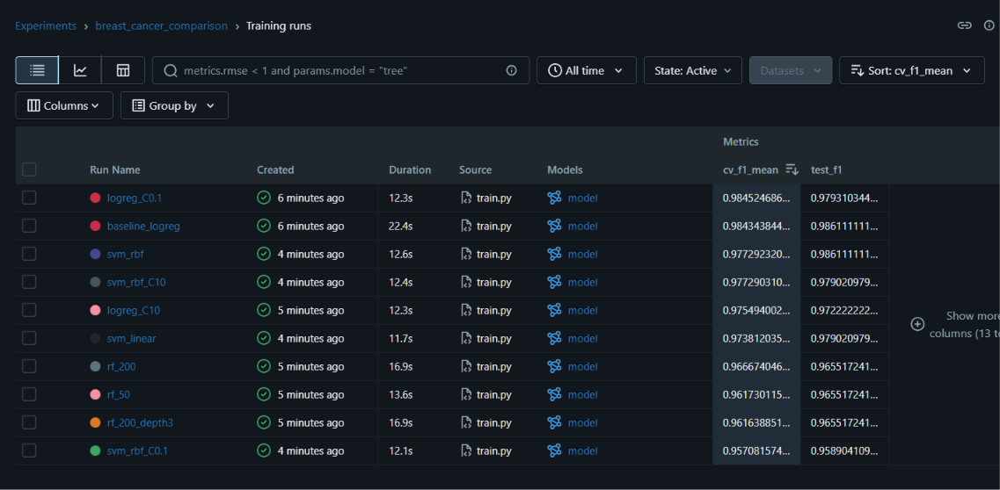

# Experiment Tracking with MLflow: Breast Cancer Classification

**Author:** M.G.H.S. Rathnayaka | **Registration No:** 2021/ICT/59 | **Course:** EL 4122 Data Science
**Project:** #28, Experiment tracking with MLflow

---

## 1. Problem and baseline

**Question:** Which model and hyperparameters best predict breast cancer malignancy, and can every run be tracked and reproduced?

**Baseline:** Logistic Regression with default settings (`C = 1.0`) on standardised features. It is simple, fast and easy to explain. The other models must beat it to justify their extra complexity.

The main goal of the project is **experiment tracking**. Ten runs were logged with MLflow (parameters, metrics and the trained model), then compared in the MLflow UI.

## 2. Data

- **Source:** the Breast Cancer Wisconsin (Diagnostic) dataset, loaded with `sklearn.datasets.load_breast_cancer`. It is public, and no personal data is involved.
- **Size:** 569 samples, 30 numeric features computed from digitised images of cell nuclei.
- **Target:** 0 = malignant (212 samples), 1 = benign (357 samples).
- **Split:** 80% train (455) and 20% test (114), stratified by class, `random_state = 42`. The same split is used for every run so the comparison is fair.

## 3. Method

Every run uses the pipeline `StandardScaler → model`. Scaling is inside the pipeline so it is fitted only on training data, which avoids data leakage.

| Model type | Runs | What was varied |
|---|---|---|
| Logistic Regression | 3 | `C` = 0.1, 1.0 (baseline), 10 |
| Random Forest | 3 | `n_estimators` = 50, 200; `max_depth` = 3 |
| SVM | 4 | kernel = linear, rbf; `C` = 0.1, 1, 10 |

**Evaluation**
- **5-fold cross-validation** on the training set (`cv_f1_mean`, `cv_f1_std`). This is used to choose the best model.
- **Held-out test set** (`test_accuracy`, `test_f1`, `test_roc_auc`). This is used as a final check.
- **F1** is the main metric because accuracy alone hides the cost of missed cancers.

**MLflow logging (per run):** model type and hyperparameters, the seed, all metrics above, and the fitted pipeline.

## 4. Results

| Run | CV F1 (5-fold) | Test F1 |
|---|---|---|
| **baseline_logreg** | 0.984 | **0.986** |
| **logreg_C0.1** | **0.985** | 0.979 |
| logreg_C10 | 0.975 | 0.972 |
| rf_50 | 0.962 | 0.966 |
| rf_200 | 0.967 | 0.966 |
| rf_200_depth3 | 0.962 | 0.966 |
| svm_linear | 0.974 | 0.979 |
| svm_rbf | 0.977 | **0.986** |
| svm_rbf_C10 | 0.977 | 0.979 |
| svm_rbf_C0.1 | 0.957 | 0.959 |

**Screenshots from the MLflow UI**




**Findings**
- **Best run by cross-validation:** `logreg_C0.1` (CV F1 = 0.985). The model was chosen on CV, not on the test score, so the test set stays an honest check.
- **The simple baseline is hard to beat.** On the test set, the baseline Logistic Regression (0.986) ties the RBF SVM (0.986) and beats every Random Forest (0.966). On a small, clean dataset with mostly linear structure, a more complex model does not automatically win.
- **The top models are practically tied.** With 114 test samples, the difference between F1 = 0.986 and 0.979 is about one prediction, so no strong claim of a single winner can be made.
- **Regularisation matters.** Very strong regularisation hurt the SVM (`svm_rbf_C0.1`: 0.959 test F1, the worst run), and weak regularisation slightly hurt Logistic Regression (`logreg_C10`).
- **Random Forest was the weakest family** here (CV F1 about 0.96), and changing its settings made little difference.

## 5. Error analysis

The best model (`logreg_C0.1`) makes only 2 or 3 errors on the 114-sample test set, which is too few to analyse. So I used **5-fold cross-validated predictions over all 569 samples** (`error_analysis.py`). Each sample is predicted by a model that never saw it. This gave **15 errors (2.6%)**. All errors are saved in `errors.csv`.

| Error type | Count |
|---|---|
| False negative (malignant predicted as benign) | 13 |
| False positive (benign predicted as malignant) | 2 |

**Observations**
1. **Most errors are borderline cases.** 8 of the 15 errors have a predicted probability of benign between about 0.39 and 0.62, so the model was close to undecided.
2. **Errors look "in between".** Most missed cancers have a mean radius of about 13 to 16, between the class averages (malignant 17.5, benign 12.2). Their features overlap with benign tumours.
3. **Some errors are confident.** 4 errors have a probability of benign of 0.85 or more. The extreme case (row 297, probability 0.986) has a small radius (11.8) and worst perimeter (85.1), both typical of benign tumours, so it looks like an unusual malignant case that this model cannot separate.
4. **False negatives dominate (13 of 15).** This is the more serious error in a medical setting, because a cancer is missed. The default threshold of 0.5 treats both error types equally, which is not ideal here.

**Possible improvements:** lower the decision threshold to catch more cancers at the cost of more false positives, optimise recall for the malignant class, or test non-linear models with tuned hyperparameters.

## 6. Limitations

- **Small test set** (114 samples). One prediction changes F1 by roughly 0.007, so small differences between models are not reliable.
- **Differences between top models are tiny** and no statistical test was run. The ranking could change with another random split.
- **Single dataset.** The finding that a simple model matches complex ones may not hold for larger or noisier data.
- **Limited tuning.** Only a few hyperparameter values were tried per model (no systematic search).
- **Error analysis used cross-validated predictions**, not the test set alone, because the test set had too few errors.
- **Not for clinical use.** This is a learning project.

## 7. How to reproduce

```cmd
python -m venv venv
venv\Scripts\activate
pip install -r requirements.txt
python train.py
python error_analysis.py
mlflow ui
```
Then open http://127.0.0.1:5000 and select the experiment `breast_cancer_comparison`.

Results are reproducible because the random seed (`42`) and the train/test split are fixed in the code.

## 8. Project structure

```
mlflow-project/
├── train.py             # trains and logs 10 runs to MLflow
├── error_analysis.py    # analyses misclassified samples of the best model
├── errors.csv           # output of the error analysis
├── requirements.txt     # package versions
├── screenshots/         # MLflow UI screenshots
└── README.md
```

## 9. What I learned

- How to log parameters, metrics and models with MLflow, and compare runs in its UI.
- Why a fixed seed, a single split and a pipeline are needed for fair, reproducible comparisons.
- That a simple baseline can match complex models, and that honest evaluation needs more than one test set score.